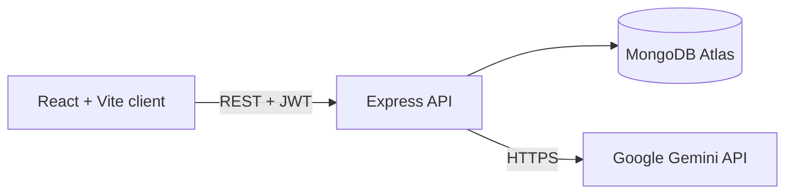

# Study Desk: AI-Powered Learning Assistant


A full-stack MERN app that turns a PDF into something you can study from. Upload your notes or a chapter, then chat with the document, get a summary, flip flashcards and take an auto-graded quiz. AI features are powered by the Google Gemini API.

**Live demo:** _add your Vercel link here_ | **Author:** [Ditwora Biswas](https://www.linkedin.com/in/ditwora-biswas-b60760214)


## Features

- Secure sign-up and login (JWT, bcrypt-hashed passwords)
- PDF upload with server-side text extraction (up to 10 MB)
- Document-grounded AI chat with conversation memory
- One-click summaries with key points
- Flashcards you can flip
- Multiple-choice quizzes with explanations and a final score
- Every user only sees their own documents

## Tech stack

| Layer | Technology |
| --- | --- |
| Frontend | React 18, Vite, React Router, Axios |
| Backend | Node.js, Express, Multer, pdf-parse |
| Database | MongoDB with Mongoose |
| AI | Google Gemini API (REST) |
| Auth | JSON Web Tokens, bcryptjs |
| Hosting | Vercel (client), Render (API), MongoDB Atlas |

## Architecture



1. The client sends a PDF to the API, which extracts the text and stores it in MongoDB.
2. For chat, summaries, flashcards and quizzes, the API sends the stored text plus a task prompt to Gemini.
3. Results are saved on the document so they load instantly next time.

## Project structure

```
.
├── client/                 React app (Vite)
│   └── src/
│       ├── pages/          Auth, Dashboard, DocumentView
│       ├── api.js          Axios instance with auth header
│       └── App.jsx         Routes and layout
├── server/                 Express API
│   ├── config/             Database connection
│   ├── middleware/         JWT auth
│   ├── models/             User, Document schemas
│   ├── routes/             auth, documents
│   ├── services/ai.js      Gemini integration
│   └── server.js           Entry point
├── docs/screenshots/       Images used in this README
├── .github/workflows/      CI
└── render.yaml             Render blueprint for the API
```

## Getting started

### Prerequisites
- Node.js 18 or newer
- A [MongoDB Atlas](https://www.mongodb.com/atlas) cluster (free tier works)
- A Gemini API key from [Google AI Studio](https://aistudio.google.com)

### 1. Clone
```bash
git clone https://github.com/<your-username>/ai-learning-assistant.git
cd ai-learning-assistant
```

### 2. Backend
```bash
cd server
cp .env.example .env     # fill in the values below
npm install
npm run dev              # http://localhost:5000
```

### 3. Frontend
```bash
cd client
cp .env.example .env
npm install
npm run dev              # http://localhost:5173
```

## Environment variables

**server/.env**

| Variable | Description |
| --- | --- |
| `PORT` | API port (default 5000) |
| `MONGO_URI` | MongoDB connection string |
| `JWT_SECRET` | Long random string used to sign tokens |
| `GEMINI_API_KEY` | Google AI Studio API key |
| `GEMINI_MODEL` | Gemini model name (default `gemini-2.5-flash`) |
| `CLIENT_URL` | Allowed frontend origin(s), comma-separated |

**client/.env**

| Variable | Description |
| --- | --- |
| `VITE_API_URL` | Base URL of the API, e.g. `http://localhost:5000/api` |

## API reference

All `/api/documents` routes require `Authorization: Bearer <token>`.

| Method | Endpoint | Description |
| --- | --- | --- |
| POST | `/api/auth/register` | Create an account |
| POST | `/api/auth/login` | Log in, returns a token |
| GET | `/api/documents` | List your documents |
| POST | `/api/documents` | Upload a PDF (`multipart/form-data`, field `file`) |
| GET | `/api/documents/:id` | Get a document with its saved study material |
| DELETE | `/api/documents/:id` | Delete a document |
| POST | `/api/documents/:id/summary` | Generate a summary |
| POST | `/api/documents/:id/chat` | Ask a question (`{ "message": "..." }`) |
| POST | `/api/documents/:id/flashcards` | Generate flashcards |
| POST | `/api/documents/:id/quiz` | Generate a quiz |
| GET | `/api/health` | Health check |

## Deployment

1. **Database:** create a MongoDB Atlas cluster and allow network access.
2. **API on Render:** create a Web Service from this repo (or use `render.yaml`), root directory `server`, build `npm install`, start `npm start`. Add the server environment variables.
3. **Client on Vercel:** import the repo, root directory `client`, Vite preset. Set `VITE_API_URL` to `https://<your-render-app>.onrender.com/api`.
4. Put the Vercel URL into `CLIENT_URL` on Render and redeploy.

Render's free tier sleeps when idle, so the first request after a break can be slow.

## Known limitations

- Scanned PDFs without selectable text are not supported.
- Very long documents are truncated before being sent to the AI.

## Roadmap

- [ ] Support DOCX and pasted text
- [ ] Streaming chat responses
- [ ] Spaced-repetition scheduling for flashcards
- [ ] Rate limiting and request validation
- [ ] Unit and integration tests

## Contributing

Issues and pull requests are welcome. See [CONTRIBUTING.md](CONTRIBUTING.md).

## License

MIT. See [LICENSE](LICENSE).
